# Forzy Motor Intelligence — Documentação Final (Challenge Sprint 4)

**Disciplina:** Front-End · **Curso:** Tecnologia em Inteligência Artificial — FIAP · **Turma:** 2TIAPY
**Challenge:** Forzy (uma empresa Promon) · **Repositório:** <https://github.com/gubalb0/SPRINT-FROTNEND>

| Integrante | RM |
|---|---|
| Gustavo Balbo Saraiva | 561711 |
| Henry Gimenez | 563217 |
| Ian Nobres | 561681 |
| Matheus Mikio | 561864 |
| Vinícius Araújo | 564504 |

---

## 1. Introdução

O Forzy Motor Intelligence é uma interface web em **Streamlit + pandas + Plotly** para monitorar motores elétricos industriais. Ao longo do semestre a solução foi construída em incrementos:

| Sprint | Entrega | Commits de referência |
|---|---|---|
| 1 | Cadastro técnico do ativo (formulário, ficha técnica, lista, dados brutos ADC → engenharia) | `bbeb791` |
| 2 | Dashboards operacionais: telemetria, séries temporais, navegação Plantas → Áreas → Ativos | `ac9fcca`, `0fcb04f`, `6577cd0`, `742aa00` |
| 3 | Painel de Alertas e Estados com camada de inteligência (modelo analítico simulado + NLP) e apoio à decisão | `9953b12` → `a3771ce` |
| **4** | **Consolidação: correções de integração, fechamento da jornada "agir", qualidade e esta documentação** | **`957c80c` → `8c9c329`** |

Este documento compara a versão entregue na Sprint 3 (commit `a3771ce`, 31/08/2026) com a versão final (Sprint 4), aponta os diferenciais e resultados, e registra o que ficou pendente com justificativa e próximos passos.

Todos os prints "antes" foram capturados rodando o commit `a3771ce`; os prints "depois" foram capturados rodando a versão final, com o mesmo roteiro (abrir → 2× *Atualizar Análise* → navegar).

---

## 2. Evolução desde a Sprint 3

### 2.1 Ponto de partida (estado na Sprint 3)

Na Sprint 3 entregamos:

- **Painel de Alertas e Estados** (`pages/operations_panel.py`) com KPIs por severidade, notificações de novo alerta e de mudança de estado, alertas ativos com resumo em linguagem natural, cards de ação recomendada (prazo, equipe, plano) e timeline de eventos.
- **Camada de serviços desacoplada**: `services/alert_engine.py` (modelo de anomalias simulado, com `CONTRATO_ALERTA`) e `services/nlp_service.py` (resumos, descrição de estado e recomendações por templates, substituível por LLM).
- **Componentes reutilizáveis** em `components/cards.py`.
- Cenário roteirizado de 5 ciclos (Normal → Atenção → Crítico) para o vídeo de demonstração.

Ao revisar essa entrega para a apresentação final, encontramos problemas de integração que **não apareciam no vídeo**, porque o roteiro sempre começava clicando no Painel:

| # | Problema encontrado na Sprint 3 | Evidência |
|---|---|---|
| P1 | O commit `09b3602` ("integra painel de alertas à navegação como página inicial") não funcionava: `utils/session.py` definia `active_page = "dashboard"` antes do `app.py`, então o app abria no Dashboard. | Fig. 1 |
| P2 | Três fontes de verdade para alertas. O Histórico e o banner do Dashboard liam `st.session_state.alertas`, uma lista **estática** criada na Sprint 2; o Painel lia o modelo. Resultado: o MTR-002 aparecia a **82 °C** no Histórico/Dashboard e a **84,3 °C** no Painel, com horários diferentes. | Fig. 3, Fig. 5 |
| P3 | O ciclo de análise morava dentro da página do Painel. Quem abrisse outra página primeiro via estados que o modelo ainda não tinha calculado. | código |
| P4 | `SAMPLE_EQUIPMENT.copy()` é cópia **rasa**: o painel alterava `eq["saude"]` nos dicionários do próprio módulo, vazando estado entre abas/sessões e impedindo o *Reiniciar Simulação* de voltar ao início. | código |
| P5 | O id do evento era `EVT-HHMMSS-i`: dois cliques no mesmo segundo geravam ids repetidos e, portanto, *keys* de botão duplicadas no Streamlit (erro em tela). | teste `test_ids_de_evento_nao_colidem_no_mesmo_segundo` |
| P6 | A jornada parava em "recomendar": o operador via o plano de ação, mas **não tinha como registrar** que assumiu o alerta. | Fig. 7 |
| P7 | Nenhum tratamento de erro: uma falha no serviço do modelo virava traceback do Python na tela. | Fig. 9 |
| P8 | `__pycache__` versionado, README ainda descrevendo a Sprint 1, nenhum teste automatizado. | repositório |

### 2.2 O que foi adicionado, alterado ou corrigido

| Categoria | Mudança | Resolve | Commit |
|---|---|---|---|
| Arquitetura | Novo `services/monitoring.py`: orquestra o ciclo de análise sem depender de Streamlit (recebe qualquer `state` mutável). Todas as páginas chamam `garantir_inicializado()`. | P2, P3 | `a7c39ec` |
| Integração | Contrato do modelo passa a ser **validado** (`alert_engine.validar_evento`). Eventos fora do contrato são descartados e registrados em `erros_contrato`, sem derrubar a tela. | P7 | `a7c39ec` |
| Rastreabilidade | Cada ciclo gera um `trace_id`, gravado em todos os eventos e exibido no painel, nos cards e no Histórico. | — | `a7c39ec` |
| Correção | Ids de evento com sufixo aleatório. | P5 | `a7c39ec` |
| Correção | Painel de Alertas passa a ser de fato a página inicial. | P1 | `3353fc7` |
| Correção | `copy.deepcopy` do seed; *Reiniciar Simulação* restaura a saúde original dos ativos. | P4 | `3353fc7` |
| Correção | Lista estática `alertas` removida; Histórico e Dashboard consomem o mesmo histórico do modelo. | P2 | `3353fc7`, `9387a01` |
| Funcionalidade | Botão **✔ Reconhecer** em cada alerta ativo, selo "RECONHECIDO hh:mm:ss", KPI **Pendentes de Ação** e badge na barra lateral. | P6 | `5dbcd3b` |
| IA / Observabilidade | Botões **👍 / 👎** em cada resumo gerado por NLP; o feedback é guardado com o `trace_id` e consolidado no Histórico ("Resumos de IA úteis"). | — | `5dbcd3b` |
| UX de erro | Falha no modelo mantém o último estado válido e mostra mensagem em português com código de suporte (o `trace_id`), além de `log.exception` no servidor. | P7 | `5dbcd3b` |
| Interface | Histórico reescrito: KPIs, filtros por severidade/TAG/pendentes, tabela colorida por severidade, exportação CSV e atalhos para Telemetria. | P2 | `9387a01` |
| Qualidade | 10 testes automatizados com `pytest` cobrindo contrato, ids, propagação de estado, reconhecimento, feedback e reinício. | P5, P8 | `8c9c329` |
| Qualidade | `.gitignore`, remoção de `__pycache__`, README atualizado. | P8 | `957c80c`, docs |

Volume: **11 arquivos alterados, +520 / −207 linhas** de código (`git diff --stat a3771ce 8c9c329`).

### 2.3 Comparativos antes / depois

**Fig. 1 — Tela inicial na Sprint 3 (abria no Dashboard, apesar do commit `09b3602`)**

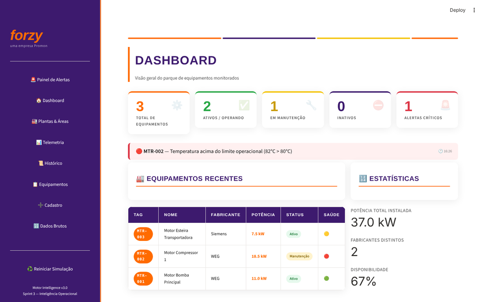

**Fig. 2 — Tela inicial na Sprint 4 (abre no Painel de Alertas e Estados, com `trace_id` do ciclo)**

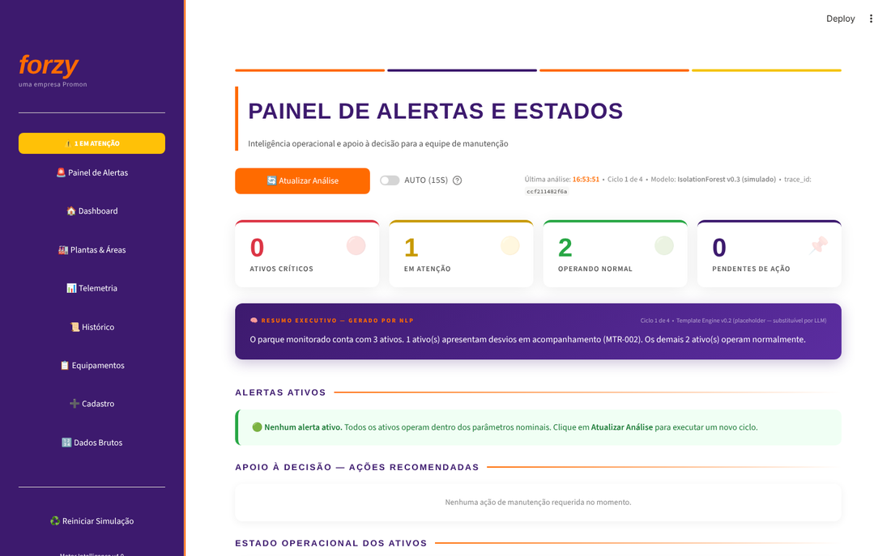

A causa estava em uma linha:

```python
# utils/session.py — Sprint 3 (a3771ce)
st.session_state.equipment_list = SAMPLE_EQUIPMENT.copy()      # cópia rasa
...
st.session_state.active_page = "dashboard"                     # anulava o app.py

# utils/session.py — Sprint 4
st.session_state.equipment_list = copy.deepcopy(SAMPLE_EQUIPMENT)
...
st.session_state.active_page = "operations_panel"
...
monitoring.garantir_inicializado(st.session_state)            # todas as páginas têm estado
```

**Fig. 3 — Histórico na Sprint 3: dados estáticos da Sprint 2 (82 °C, mensagens fixas, MTR-001 listado como evento)**

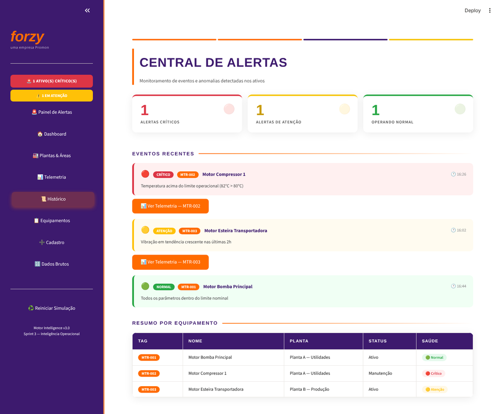

**Fig. 4 — Histórico na Sprint 4: os mesmos eventos do modelo (84,3 °C), status de reconhecimento, feedback de IA, `trace_id`, filtros e CSV**

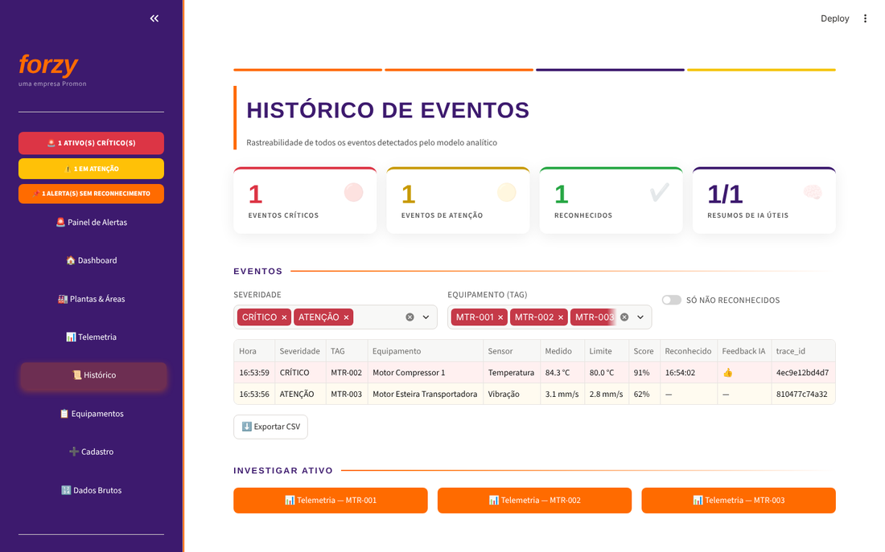

**Fig. 5 — Banner do Dashboard: Sprint 3 (acima, dado estático) × Sprint 4 (abaixo, mesmo evento do Painel)**

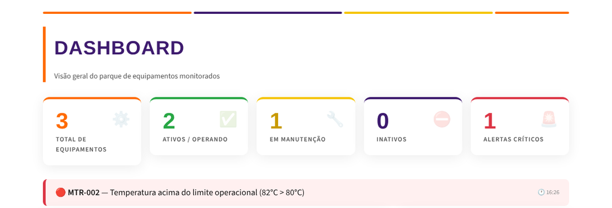
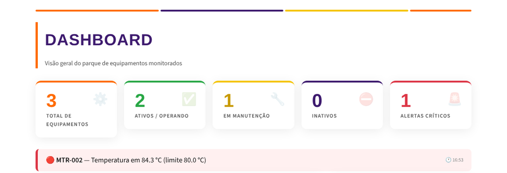

Orquestração que saiu da página para o serviço:

```python
# pages/operations_panel.py — Sprint 3: regra de negócio dentro da página
def _executar_ciclo():
    ciclo = st.session_state.ciclo_analise
    eventos, estados = alert_engine.detectar_anomalias(ciclo)
    ...

# services/monitoring.py — Sprint 4: serviço puro, testável com dict
def executar_ciclo(state) -> dict:
    trace_id = novo_trace_id()
    eventos_brutos, estados = alert_engine.detectar_anomalias(ciclo)
    for ev in eventos_brutos:
        problemas = alert_engine.validar_evento(ev)
        if problemas:                      # descarta e registra, não quebra a tela
            erros.append({"trace_id": trace_id, "evento": ev.get("id"), "problemas": problemas})
            continue
        ev["trace_id"] = trace_id
        ...
```

---

## 3. Diferenciais e Resultados da Solução

### 3.1 Diferenciais técnicos e de experiência

- **Cores semânticas únicas em todo o sistema.** `components/cards.py` define `CORES` (vermelho = crítico, amarelo = atenção, verde = normal) e todas as telas usam o mesmo mapa: KPI, borda do card, badge, timeline, linha da tabela do Histórico e badges da barra lateral. A identidade Forzy/Promon (laranja `#FF6B00`, roxo `#3D1A6E`, Barlow Condensed + Inter) é aplicada por `utils/theme.py`.
- **Desacoplamento em três camadas** (Fig. 6): páginas só apresentam; `services/` contém modelo, NLP e orquestração; o estado é uma fonte única. O modelo e o motor de NLP podem ser trocados sem mexer em nenhuma página, pois o contrato (`CONTRATO_ALERTA`) agora é validado em tempo de execução.
- **Componentização.** `card_alerta`, `card_recomendacao`, `painel_estado`, `timeline_eventos` e `bloco_resumo_executivo` recebem dicionários prontos e são reaproveitados.
- **Uso de IA / NLP.** Resumo executivo do parque, resumo de cada alerta (valor, limite, desvio %, causa provável, confiança), descrição do estado do ativo e plano de ação por métrica e severidade. Todo texto de IA é rotulado como tal ("Resumo gerado por NLP") e mostra o modelo que o produziu.
- **Rastreabilidade.** `trace_id` por ciclo em cada evento, horário de reconhecimento por alerta, feedback do operador ligado ao `trace_id`, exportação CSV.
- **Tratamento amigável de erros.** O operador nunca vê traceback; vê o que aconteceu, que os dados são do último ciclo válido e um código para o suporte (Fig. 9).

**Fig. 6 — Arquitetura entregue na Sprint 4**

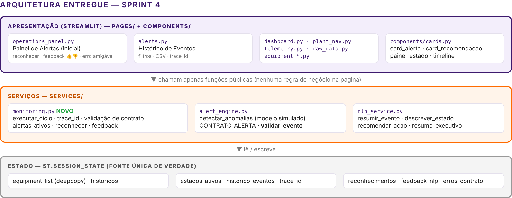

### 3.2 Jornada do usuário: monitorar → receber alerta → agir

1. **Monitorar.** O app abre no Painel de Alertas e Estados. KPIs, resumo executivo e estado de cada ativo. A barra lateral mostra em qualquer página quantos ativos estão críticos, em atenção e quantos alertas ainda não foram reconhecidos.
2. **Receber alerta.** A cada ciclo (manual ou automático a cada 15 s) o modelo gera eventos. Aparece a notificação "Novo alerta crítico", a mudança de estado é destacada com animação e o card mostra o resumo em linguagem natural.
3. **Agir.** O operador lê o plano de ação (prazo, equipe responsável, passos), abre a **Telemetria** ou a **Ficha técnica** do ativo direto do card, clica em **✔ Reconhecer** para assumir o alerta e avalia o resumo da IA com 👍/👎. O KPI *Pendentes de Ação* cai e o Histórico registra quem tratou o quê e quando.

**Fig. 7 — Painel na Sprint 3: o operador lia a recomendação mas não tinha como registrar a ação**

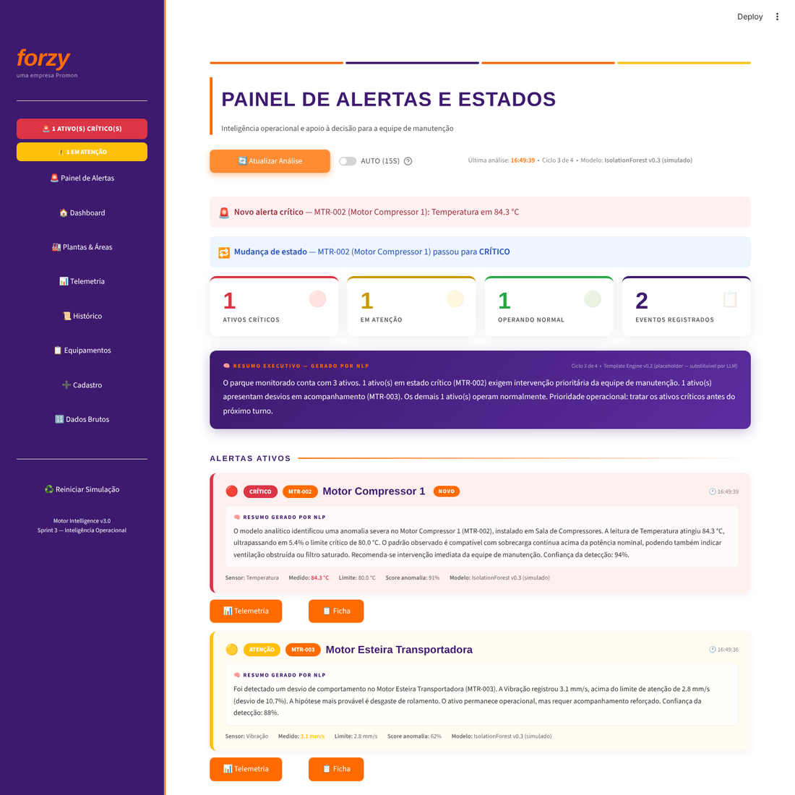

**Fig. 8 — Painel na Sprint 4: alerta crítico reconhecido, feedback registrado, KPI "Pendentes de Ação" e badge na barra lateral**

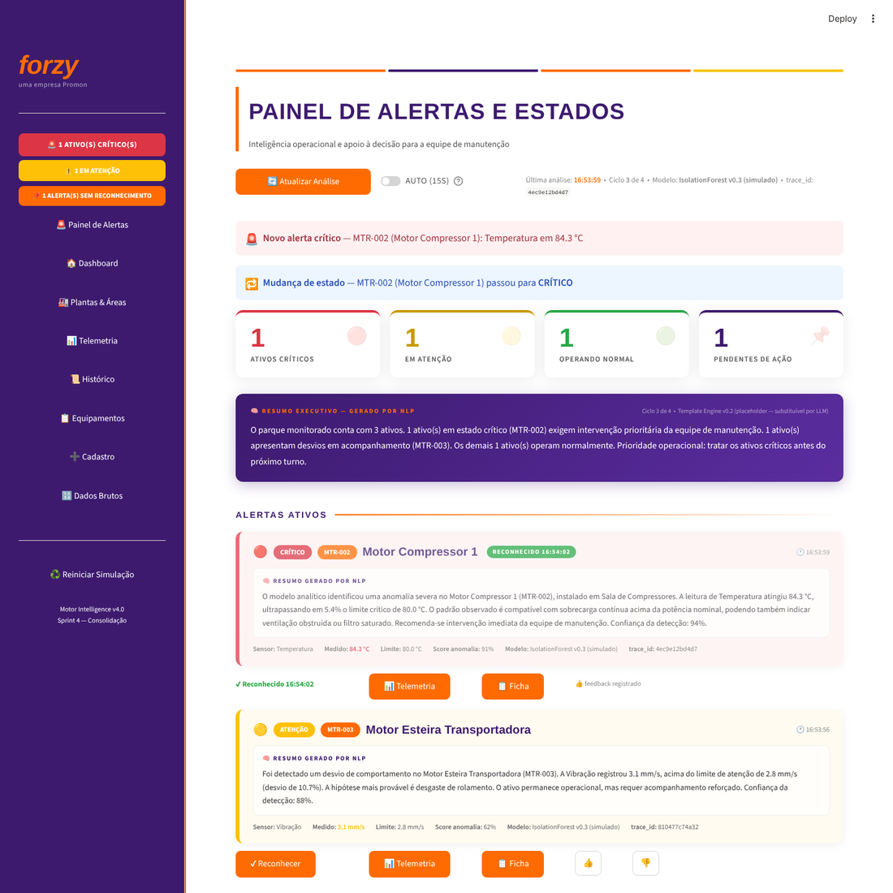

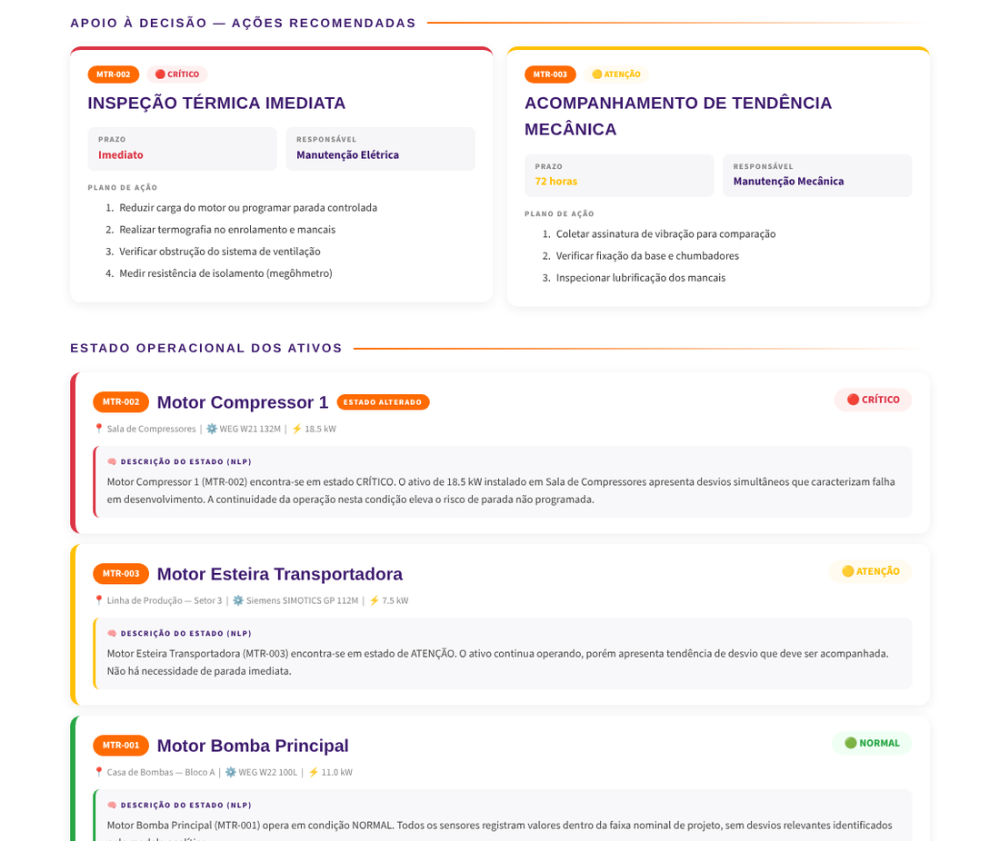

**Fig. 9 — Falha simulada do modelo (`FORZY_SIMULAR_FALHA=1`): mensagem amigável com código, painel continua usável**

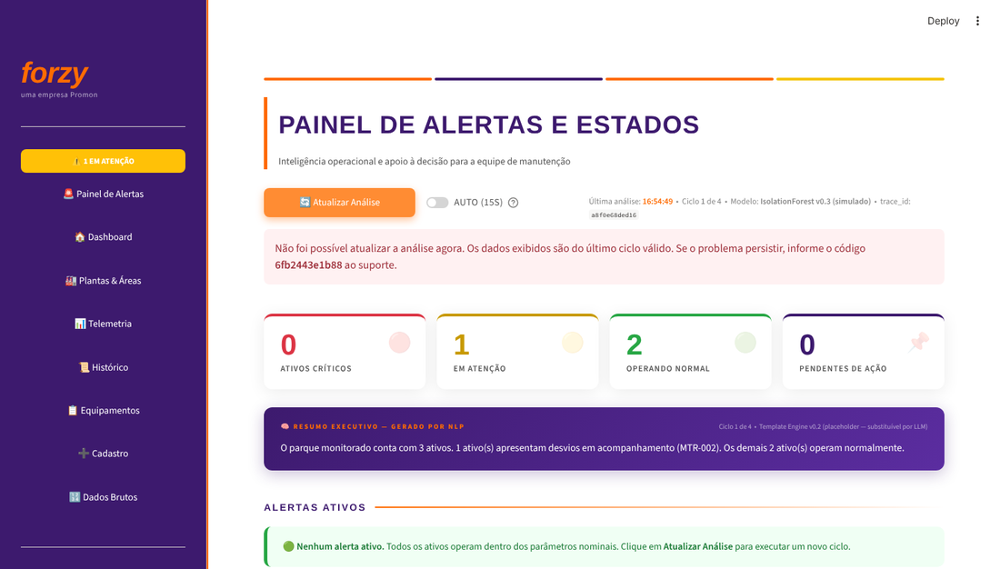

### 3.3 Funcionalidades integradas e evidências de funcionamento

| Funcionalidade | Onde | Evidência |
|---|---|---|
| Cadastro, edição, ficha técnica, lista com filtros | `equipment_form.py`, `equipment_list.py` | Sprint 1 |
| Conversão ADC → unidades de engenharia | `raw_data.py` | Sprint 1 |
| Telemetria com séries temporais e leitura de placa (OCR) | `telemetry.py` | Sprint 2 |
| Navegação Plantas → Áreas → Ativos com saúde agregada | `plant_nav.py` | Sprint 2 |
| Detecção de anomalias e transição de estados | `alert_engine.py` + `monitoring.py` | Fig. 8, testes |
| Resumos e recomendações por NLP | `nlp_service.py` | Fig. 8, teste NLP |
| Reconhecimento, feedback, `trace_id`, CSV | `monitoring.py`, `alerts.py` | Fig. 4, Fig. 8 |
| Tratamento de erro | `operations_panel.py` | Fig. 9 |

Resultado dos testes automatizados:

```
$ python -m pytest -q
..........                                                               [100%]
10 passed in 0.02s
```

### 3.4 Como a solução atende ao Challenge Forzy

O problema proposto é transformar dados de motores elétricos em decisão de manutenção antes da falha. A solução cobre a cadeia completa, do cadastro técnico do ativo até a ação registrada: (1) o ativo é cadastrado com seus dados de placa; (2) a telemetria é convertida em unidades de engenharia e exibida em séries temporais; (3) a camada analítica classifica o estado de cada motor; (4) o NLP traduz o desvio em linguagem do operador e propõe um plano com prazo e equipe; (5) o operador assume o alerta e o histórico fica rastreável. Como modelo e NLP estão atrás de contratos validados, a Forzy pode plugar seus modelos reais sem refazer a interface.

---

## 4. Pendências, Justificativas e Melhorias Futuras

### 4.1 O que ficou pendente ou parcial

| # | Pendência | Situação | Por que não foi feito |
|---|---|---|---|
| 1 | Modelo de anomalias real | **Simulado** (cenário roteirizado de 5 ciclos rotulado "IsolationForest v0.3 (simulado)") | Não tivemos dados reais de motores da Forzy para treinar; o treino é escopo das disciplinas de ML. Mantivemos o contrato pronto para a troca. |
| 2 | LLM no lugar dos templates de NLP | **Parcial**: textos dinâmicos por template | Custo e chave de API, latência dentro do Streamlit e necessidade de avaliação de alucinação; decisão de escopo da disciplina de Front-End. |
| 3 | Telemetria acompanhar o ciclo do modelo | **Parcial**: as séries temporais são geradas uma vez na abertura, a partir da saúde inicial do ativo | Exigiria regenerar o histórico por ciclo; priorizamos a consistência dos alertas (P2). |
| 4 | Persistência | **Não feito**: tudo vive em `st.session_state` e é perdido ao recarregar a página | Depende de back-end/banco (ver seção 5); fora do escopo de Front-End. |
| 5 | Autenticação e identificação do operador | **Não feito**: o reconhecimento grava "Operador" fixo | Depende de back-end e de política de acesso da empresa. |
| 6 | CSS centralizado | **Parcial**: parte do estilo ainda é inline nas páginas e componentes | Limitação do `st.markdown` com HTML; refatorar tudo antes da apresentação trazia risco de regressão visual. |
| 7 | Integração com sensores reais (MQTT/API) e alertas por e-mail/webhook | **Não feito** (estava no roadmap da Sprint 1) | Sem acesso a hardware/infraestrutura da Forzy; dependência de outras disciplinas. |
| 8 | Testes de interface | **Não feito**: só os serviços têm teste | `streamlit.testing` ainda é limitado para HTML customizado; priorizamos testar a lógica. |

### 4.2 Melhorias e próximos passos (priorizados)

| Prioridade | Melhoria | Viabilidade | Esforço estimado |
|---|---|---|---|
| 1 | Persistir eventos, reconhecimentos e feedback em SQLite | Alta — `monitoring.py` já isola a escrita de estado | 1–2 dias |
| 2 | Regenerar telemetria a cada ciclo, coerente com o evento (pico de temperatura no gráfico quando o alerta dispara) | Alta — só front + `session.py` | 1 dia |
| 3 | Trocar `nlp_service` por LLM com prompt fixo, *fallback* para template e exibição do feedback 👍/👎 como métrica de qualidade | Média — assinatura já pronta | 2–3 dias |
| 4 | Plugar modelo treinado (IsolationForest real) mantendo `CONTRATO_ALERTA` | Média — depende de dados | 3–5 dias |
| 5 | Extrair API FastAPI e autenticação (seção 5) | Média | 1–2 semanas |
| 6 | Mover todo CSS inline para `utils/theme.py` e adicionar testes de UI com `streamlit.testing.v1.AppTest` | Alta | 2 dias |

---

## 5. Ir além (proposta): separar front-end e back-end com FastAPI

Proposta de arquitetura alinhada à direção de produção estudada no semestre. Não foi implementada; o código atual já foi preparado para ela, porque as páginas só conversam com `services/`.

**Fig. 10 — Arquitetura proposta**

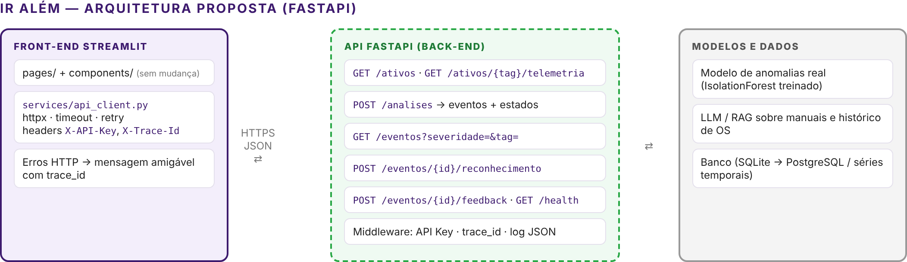

### 5.1 Endpoints

| Método | Rota | Função atual que substitui |
|---|---|---|
| `GET` | `/ativos` | `SAMPLE_EQUIPMENT` / `equipment_list` |
| `GET` | `/ativos/{tag}/telemetria?horas=24` | `gerar_historico` |
| `POST` | `/analises` | `monitoring.executar_ciclo` |
| `GET` | `/eventos?severidade=&tag=&pendentes=` | `historico_eventos` / `alertas_ativos` |
| `POST` | `/eventos/{id}/reconhecimento` | `monitoring.reconhecer_alerta` |
| `POST` | `/eventos/{id}/feedback` | `monitoring.registrar_feedback` |
| `GET` | `/health` | — |

### 5.2 Contrato HTTP e observabilidade

- **Autenticação:** header `X-API-Key` validado por *dependency* do FastAPI; 401 com corpo `{"erro": "...", "trace_id": "..."}`.
- **Rastreio:** o front envia `X-Trace-Id`; a API gera um se não vier, devolve no header de resposta e grava em log JSON. É o mesmo `trace_id` que hoje aparece na tela, então o código mostrado ao operador na Fig. 9 passa a localizar o log no servidor.
- **Erros amigáveis:** `api_client.py` (httpx com timeout de 5 s e 1 retry) converte timeout/5xx na mensagem atual do painel; 422 de validação vira aviso de contrato.
- **Feedback de IA:** `POST /eventos/{id}/feedback` alimenta uma métrica "% de resumos úteis" por versão de modelo/prompt.

### 5.3 Plano de migração

1. Criar `services/api_client.py` com as **mesmas assinaturas** de `monitoring.py` e um *flag* `FORZY_BACKEND=local|api`.
2. Subir a API com os serviços atuais copiados para o back-end (mesmo comportamento, agora via HTTP).
3. Trocar `session_state` por banco no back-end; o front fica só com cache de tela.
4. Adicionar API Key e log estruturado; desligar o modo `local`.

---

## 6. Conclusão

A Sprint 4 transformou o protótipo da Sprint 3 em uma aplicação coerente: o app abre onde deve, todas as telas mostram os mesmos números, a jornada termina em uma ação registrada, falhas aparecem de forma compreensível e a lógica tem testes. Os diferenciais (cores semânticas, componentização, camada de IA desacoplada e rastreabilidade por `trace_id`) deixam a interface pronta para receber o modelo e o LLM reais e para a separação em API proposta na seção 5. As pendências estão concentradas no que depende de dados reais e de back-end, e não na camada de Front-End.

---

### Como executar

```bash
pip install -r requirements.txt
streamlit run app.py                       # http://localhost:8501
pip install pytest && python -m pytest -q  # testes dos serviços
FORZY_SIMULAR_FALHA=1 streamlit run app.py # demonstra o tratamento de erro
```
